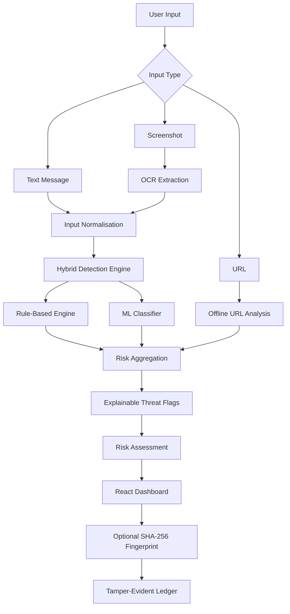

# 👻 Phantom Guard
### See the red flags. Outsmart the scams.

**An AI-powered scam and phishing detection shield built to protect everyday internet users, with a special focus on India.**

Phantom Guard helps users identify suspicious messages, phishing links, fraudulent offers and potential scams before they become victims.

Using a combination of Machine Learning, Natural Language Processing and rule-based threat analysis, Phantom Guard detects suspicious patterns and explains them in simple, understandable language.

Unlike conventional scam detectors that primarily focus on standard English, Phantom Guard is designed to understand **English, Hindi and Hinglish**, including informal, romanized Hindi commonly used in everyday Indian conversations.

---

## ✨ What Makes Phantom Guard Different?

- 🧠 **Hybrid AI Detection:** Combines machine learning predictions with a rule-based threat detection engine.
- 🇮🇳 **Multilingual Intelligence:** Designed to analyse English, Hindi and Hinglish messages.
- 👻 **Explainable Threat Detection:** Every detected red flag appears as a named ghost with a simple explanation.
- 🔗 **Phishing Link Analysis:** Identifies suspicious URLs using offline security heuristics without visiting potentially malicious websites.
- 📸 **Screenshot Scanning:** Extracts text from uploaded screenshots using Optical Character Recognition (OCR).
- 🔐 **Privacy-First Architecture:** Uses SHA-256 fingerprints for optional threat reporting without storing raw message content.
- ⛓️ **Tamper-Evident Threat Ledger:** Explores cryptographic verification of previously reported scams.
- 🎨 **Interactive Experience:** A playful, animated interface designed to make cybersecurity approachable.

---

## 🎯 The Problem

Online scams are becoming increasingly sophisticated.

Indian internet users regularly encounter:

- Fake investment opportunities promising guaranteed returns.
- Fraudulent banking and KYC verification messages.
- UPI payment scams.
- Fake job and internship offers.
- Lottery and prize-winning scams.
- Phishing links impersonating trusted organisations.
- Social engineering and impersonation attempts.

Many existing detection tools struggle with informal language, spelling variations, Hindi and Hinglish communication.

Phantom Guard aims to make scam detection accessible, understandable and useful for ordinary people.

---

## ⚙️ How It Works

1. **Submit:** Paste a suspicious message, enter a URL or upload a screenshot.
2. **Analyse:** The hybrid detection engine examines suspicious patterns and ML predictions.
3. **Identify:** Potential red flags are extracted and categorised.
4. **Understand:** Each red flag is explained in simple language.
5. **Verify:** Optionally check whether the same message fingerprint has been reported previously.
6. **Stay Safe:** Receive a risk assessment and recommendations.

---

## 🛡️ Core Features

### 1. AI-Powered Scam Detection

A hybrid detection engine combines:

- TF-IDF text feature extraction.
- Word and character n-grams.
- Logistic Regression classification.
- Rule-based scam pattern detection.
- Explainable feature contributions.

The system produces a risk score between 0 and 100.

| Risk Score | Verdict |
|---|---|
| 0–30 | Looks calm |
| 31–65 | Be careful |
| 66–100 | Likely a scam |

*Thresholds are initial design choices and will be calibrated during evaluation.*

### 2. Ghost-Based Threat Explanations

Instead of displaying complicated security terminology, Phantom Guard introduces friendly cartoon characters representing different scam indicators.

| Ghost | What it detects |
|---|---|
| Urgency Wraith | Pressure to act immediately |
| Guaranteed-Returns Poltergeist | Unrealistic investment promises |
| Fake-Authority Phantom | Impersonation of trusted institutions |
| Payment-Pull Banshee | Suspicious payment requests |
| Secrecy Spook | Attempts to prevent verification |
| Shouting Gremlin | Excessive capitalisation and aggressive language |

Each ghost explains the suspicious pattern in one simple sentence.

### 3. Multilingual Detection

Phantom Guard targets three communication styles:

- English
- Hindi (Devanagari)
- Hinglish (Romanized Hindi mixed with English)

The goal is to make scam detection work with the language people actually use, rather than requiring perfectly written English.

### 4. Phishing URL Analysis

The link analyser examines suspicious URL characteristics, including:

- URL shorteners.
- IP-address-based hosts.
- Punycode domains.
- Suspicious subdomains.
- Potential brand impersonation.
- Suspicious top-level domains.
- Display-text and destination mismatches.

**Security decision:** User-submitted URLs are never fetched or opened by the backend.

### 5. Screenshot Analysis

Users can upload screenshots of suspicious conversations and messages.

OCR extracts the text, which is then passed through the same analysis pipeline.

Images are processed in memory and are not stored.

### 6. Privacy-Preserving Scam Ledger

An optional reporting mechanism uses SHA-256 fingerprints of normalised message text.

The ledger aims to:

- Identify previously reported messages.
- Prevent duplicate reports.
- Maintain tamper-evident records.
- Allow independent verification of recorded fingerprints.

Raw messages and screenshots are never intentionally stored in the ledger.

*Important: Hashes of short or predictable messages can potentially be guessed. Hashing alone does not guarantee anonymity.*

---

## 🧰 Tech Stack

| Component | Technology |
|---|---|
| Frontend | React, Vite, TypeScript |
| Styling | CSS Variables |
| Animations | Framer Motion |
| Backend | Python, FastAPI |
| Data Validation | Pydantic |
| Machine Learning | Scikit-learn |
| NLP | TF-IDF, Character & Word N-grams |
| OCR | Tesseract |
| Database | PostgreSQL |
| Cryptography | SHA-256 |
| Blockchain (planned) | Stellar Soroban |
| Testing | Pytest, Hypothesis, Vitest |

---

## 🏗️ Architecture



---

## 🔒 Security & Privacy

Security is a core design principle, not an optional feature.

Phantom Guard aims to implement:

- Input validation and size restrictions.
- API rate limiting.
- Strict CORS configuration.
- Content Security Policy and security headers.
- Secure authentication and session management where required.
- Protection against XSS and injection attacks.
- Safe handling of uploaded images.
- No fetching of user-submitted URLs.
- No hardcoded API keys or secrets.
- Privacy-conscious logging.

For additional security information, see:

- `docs/THREAT_MODEL.md`
- `docs/RESPONSIBLE_AI.md`

---

## 📊 Machine Learning & Evaluation

The initial ML model uses TF-IDF feature extraction with Logistic Regression.

Training data will combine appropriately licensed public datasets with independently authored Indian-context examples.

Evaluation will include:

- Precision
- Recall
- F1-score
- Confusion matrix
- Per-language performance analysis

Hard negatives will include legitimate bank alerts, OTP messages, delivery notifications and ordinary conversations.

Model performance will be reported using actual held-out evaluation results. No unmeasured accuracy claims will be presented.

---

## 📁 Project Structure

```text
phantom-guard/
│
├── frontend/
│   ├── public/
│   ├── src/
│   │   ├── assets/
│   │   ├── components/
│   │   ├── pages/
│   │   ├── hooks/
│   │   ├── services/
│   │   ├── styles/
│   │   └── App.tsx
│   └── package.json
│
├── backend/
│   ├── app/
│   │   ├── routes/
│   │   ├── services/
│   │   ├── models/
│   │   ├── security/
│   │   └── main.py
│   ├── tests/
│   └── requirements.txt
│
├── ml/
│   ├── data/
│   ├── models/
│   ├── scripts/
│   ├── evaluation/
│   └── README.md
│
├── contracts/
│   └── README.md
│
├── docs/
│   ├── DATA.md
│   ├── RESPONSIBLE_AI.md
│   ├── THREAT_MODEL.md
│   └── DEMO_SCRIPT.md
│
├── .gitignore
├── .env.example
├── LICENSE
└── README.md
```

---

## 🚀 Getting Started

Phantom Guard is currently under development. Setup instructions will be finalised alongside the implementation of the frontend and backend.

### Prerequisites

- Node.js and npm
- Python 3.11
- Git

### Clone the repository

```bash
git clone https://github.com/YOUR_USERNAME/phantom-guard.git

cd phantom-guard
```

### Frontend

```bash
cd frontend

npm install

npm run dev
```

### Backend

```bash
cd backend

python -m venv venv
```

Activate the virtual environment.

Windows:

```bash
venv\Scripts\activate
```

Install dependencies:

```bash
pip install -r requirements.txt
```

Run the development server:

```bash
uvicorn app.main:app --reload
```

*Commands and dependencies will be updated as the application develops.*

---

## 🧪 Testing

Testing will cover:

- ML model evaluation.
- API functionality.
- Input validation.
- Arbitrary text handling.
- Risk score boundaries.
- Rule-engine consistency.
- URL parsing and analysis.
- Security-related test cases.
- Frontend accessibility and responsiveness.

---

## 🤖 Responsible AI

Phantom Guard is designed to assist users in recognising suspicious activity, not to make decisions on their behalf.

Important limitations:

- A high-risk score does not prove that a message is fraudulent.
- A low-risk score does not guarantee safety.
- Small training datasets may produce language-specific performance gaps.
- False positives can cause users to distrust legitimate communications.
- AI-generated explanations must be grounded in detected evidence.

Phantom Guard does not provide legal or financial advice and does not guarantee protection against every scam.

See `docs/RESPONSIBLE_AI.md` for further information.

---

## 🗺️ Development Roadmap

- [x] Project concept and technical architecture
- [ ] Repository and project structure
- [ ] Frontend foundation and design system
- [ ] Animated mascot and interactive UI
- [ ] Backend API development
- [ ] Rule-based scam detection
- [ ] Multilingual ML classification
- [ ] Screenshot OCR integration
- [ ] Phishing URL analysis
- [ ] Explainable AI integration
- [ ] Privacy-preserving scam fingerprinting
- [ ] Tamper-evident ledger
- [ ] Security testing and evaluation
- [ ] Deployment and documentation

---

## 🌍 Vision

The internet should be accessible without making people vulnerable to deception.

Phantom Guard aims to bridge the gap between advanced cybersecurity technology and everyday users by making digital threat detection intelligent, transparent and understandable.

**Because staying safe online shouldn't require being a cybersecurity expert.**

---

## 📜 License

This project is licensed under the MIT License. See the `LICENSE` file for details.

---

**Built with curiosity, code and a little ghostly protection. 👻**

*Phantom Guard — See the red flags. Outsmart the scams.*
